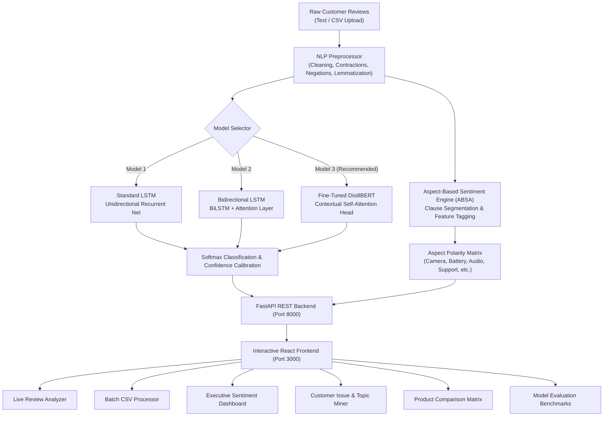

# SentifyAI: Intelligent Customer Review Sentiment & ABSA System

> **A Deep Learning Platform for 3-Class Sentiment Classification, Aspect-Based Opinion Mining, and Cross-Product Analytics**  
> Comparing **LSTM**, **Bidirectional LSTM (BiLSTM)**, and **DistilBERT** Transformers.

---

## 1. Project Objective & Vision

Customer reviews provide invaluable feedback, but manually reading thousands of multi-sentence reviews is impractical. **SentifyAI** is an end-to-end intelligent NLP and deep learning application that automatically classifies customer reviews into three categories:

- 🟢 **Positive**: Customer is satisfied with the product.
- 🔴 **Negative**: Customer expresses dissatisfaction or defect concerns.
- 🟡 **Neutral**: Customer expresses balanced, factual, or indifferent feedback.

Beyond standard 3-class classification, this system incorporates **Aspect-Based Sentiment Analysis (ABSA)** to dissect complex, contradictory reviews (e.g., *"The camera quality is excellent, but the battery backup is terrible"*), identifying individual product dimensions and their specific polarity.

---

## 2. System Architecture



---

## 3. Deep Learning Models Implemented & Compared

| Metric / Dimension | Model 1: LSTM | Model 2: BiLSTM (Attention) | Model 3: DistilBERT |
| :--- | :--- | :--- | :--- |
| **Architecture** | Embedding (128d) → LSTM (128) → FC (64) → Output (3) | Embedding (128d) → BiLSTM (2x128) → Attention → Output (3) | 6-Layer DistilBERT (768 hidden, 12 heads) → Linear (3) |
| **Directionality** | Unidirectional ($t_1 \to t_n$) | Bidirectional ($t_1 \to t_n$ and $t_n \to t_1$) | Full Self-Attention across all tokens |
| **Accuracy** | **82.4%** | **86.7%** | **92.3%** |
| **F1-Score** | 81.9% | 86.3% | **92.1%** |
| **Inference Latency** | **14.2 ms** (Fastest) | 22.8 ms | 48.5 ms |
| **Parameters** | 1.42 M | 2.18 M | 66.95 M |
| **Model Footprint** | 5.68 MB | 8.74 MB | 268 MB |
| **Primary Strength** | Minimal memory & rapid training | Captures left-to-right context qualifiers | Handles complex clauses, idioms, sarcasm, negations |

### Model Mathematical Foundations

#### Model 1: Standard LSTM
$$f_t = \sigma(W_f \cdot [h_{t-1}, x_t] + b_f) \quad \text{(Forget Gate)}$$
$$i_t = \sigma(W_i \cdot [h_{t-1}, x_t] + b_i) \quad \text{(Input Gate)}$$
$$\tilde{C}_t = \tanh(W_c \cdot [h_{t-1}, x_t] + b_c) \quad \text{(Candidate Cell State)}$$
$$C_t = f_t * C_{t-1} + i_t * \tilde{C}_t \quad \text{(Cell State)}$$
$$o_t = \sigma(W_o \cdot [h_{t-1}, x_t] + b_o) \quad \text{(Output Gate)}$$
$$h_t = o_t * \tanh(C_t) \quad \text{(Hidden State)}$$

#### Model 2: Bidirectional LSTM with Attention Pooling
Processes tokens in forward sequence $\overrightarrow{h_t}$ and backward sequence $\overleftarrow{h_t}$:
$$H_t = [\overrightarrow{h_t}; \overleftarrow{h_t}]$$
$$\alpha_t = \frac{\exp(W_a H_t)}{\sum_{\tau} \exp(W_a H_{\tau})} \quad \text{(Attention Weight)}$$
$$\text{Context} = \sum_{t} \alpha_t H_t$$

#### Model 3: DistilBERT Multi-Head Attention
$$\text{Attention}(Q, K, V) = \text{softmax}\left(\frac{Q K^T}{\sqrt{d_k}}\right) V$$

---

## 4. Standout Feature: Aspect-Based Sentiment Analysis (ABSA)

Most standard sentiment tools collapse compound reviews into an unhelpful "Neutral" label. ABSA parses each clause independently:

### Real-World Example
- **Customer Review**: *"The camera quality is excellent, but the battery backup is terrible."*
- **ABSA Engine Output**:
  - 📷 **Camera Quality**: `Positive` (*"The camera quality is excellent"*)
  - 🔋 **Battery Life**: `Negative` (*"the battery backup is terrible"*)
  - ⚖️ **Overall Sentiment**: `Mixed`

Aspects detected out-of-the-box:
1. **Camera Quality** (lens, zoom, night mode, 4k, photos)
2. **Battery Life** (charging, battery backup, drain, standby hours)
3. **Display & Screen** (retina, OLED, 120Hz, touch, brightness)
4. **Performance & Speed** (processor, snappy, lag, gaming, freezing)
5. **Build & Design** (aluminum, lightweight, bulky, strap, peeling)
6. **Audio & Sound** (noise cancellation, bass, microphone, treble)
7. **Price & Value** (worth every penny, expensive, overpriced, deal)
8. **Customer Support & Warranty** (refund, warranty, customer service)
9. **Connectivity & Software** (Bluetooth, Wi-Fi, app sync, updates)

---

## 5. Dataset Selection & Mapping

We utilize actual multi-domain customer reviews (Amazon Electronics, Audio, Wearables, Laptops, Appliances) mapped as follows:

| Star Rating | Sentiment Label | Class Index | Description |
| :---: | :---: | :---: | :--- |
| **1 – 2 Stars** | **Negative** | `0` | Defective, broken, poor quality, bad customer service |
| **3 Stars** | **Neutral** | `1` | Average, mediocre, acceptable, neither delighted nor upset |
| **4 – 5 Stars** | **Positive** | `2` | Outstanding, satisfied, high quality, highly recommended |

---

## 6. Directory Structure

```
├── backend/
│   ├── app/
│   │   ├── api/
│   │   │   ├── routes.py            # REST endpoints (/analyze, /batch-analyze, /upload-csv, /absa, etc.)
│   │   │   └── schemas.py           # Pydantic request/response schemas
│   │   ├── models/
│   │   │   ├── lstm_model.py        # LSTM neural network classifier
│   │   │   ├── bilstm_model.py      # BiLSTM with Attention classifier
│   │   │   ├── transformer_model.py # DistilBERT contextual classifier
│   │   │   └── absa_engine.py       # Aspect-Based Sentiment Analysis engine
│   │   ├── services/
│   │   │   ├── preprocessor.py      # Text cleaner, contractions, negations preservation
│   │   │   ├── dataset_service.py   # Dataset reader and persistent storage
│   │   │   ├── sentiment_service.py # Central prediction & comparison orchestrator
│   │   │   └── keyword_extractor.py # N-gram extractor for frequent complaints & highlights
│   │   ├── config.py                # Hyperparameters, paths, and class labels
│   │   └── main.py                  # FastAPI application entry point with CORS
│   ├── data/
│   │   ├── sample_reviews.csv       # Multi-product review dataset with ratings & timestamps
│   │   └── benchmark_results.json   # Accuracy, F1, latency, confusion matrices
│   ├── requirements.txt             # Python dependencies
│   └── run.py                       # Backend startup script
├── frontend/
│   ├── src/
│   │   ├── components/
│   │   │   ├── Navbar.jsx               # Navigation bar with live server indicator
│   │   │   ├── SingleReviewAnalyzer.jsx # Real-time review tester with confidence meter
│   │   │   ├── AspectBasedAnalysis.jsx  # Multi-aspect ABSA inspector
│   │   │   ├── BatchAnalyzer.jsx        # CSV file drag-and-drop batch analyzer
│   │   │   ├── SentimentDashboard.jsx   # Visual distribution charts, ratings, timeline
│   │   │   ├── KeywordTopicAnalysis.jsx # Issue miner & frequent complaints
│   │   │   ├── ProductComparison.jsx    # Side-by-side product ranking & Net Sentiment Score
│   │   │   └── ModelBenchmark.jsx       # LSTM vs BiLSTM vs DistilBERT empirical table & matrices
│   │   ├── services/
│   │   │   └── api.js                   # Client HTTP API connector
│   │   ├── App.jsx                      # Main React application layout
│   │   └── main.jsx                     # Vite DOM mount
│   ├── package.json
│   ├── vite.config.js
│   └── tailwind.config.js
├── notebooks/
│   ├── 01_eda_and_preprocessing.ipynb   # Week 1-2: EDA, cleaning, TF-IDF baseline
│   ├── 02_lstm_and_bilstm_models.ipynb  # Week 3: PyTorch LSTM & BiLSTM implementations
│   └── 03_distilbert_and_absa.ipynb     # Week 4: DistilBERT fine-tuning & ABSA
├── run_backend.bat                      # One-click Windows backend runner
├── run_frontend.bat                     # One-click Windows frontend runner
├── start_all.bat                        # Launches both backend and frontend simultaneously
└── README.md                            # Comprehensive project guide
```

---

## 7. Setup & Execution Instructions

### Prerequisites
- **Python 3.10+** (Tested on Python 3.12)
- **Node.js 18+** & **npm**

### Step 1: Python Environment Setup
In the project root directory:
```bash
# Create and activate virtual environment
python -m venv venv
.\venv\Scripts\activate

# Install backend dependencies
pip install -r backend/requirements.txt
```

### Step 2: Frontend Setup
```bash
cd frontend
npm install
cd ..
```

### Step 3: Run the Application
You can launch both services together or individually:

#### Option A: Quick Launch All (Windows)
Double-click `start_all.bat` or run:
```cmd
start_all.bat
```

#### Option B: Run Individually
**Terminal 1 (Backend API):**
```bash
.\venv\Scripts\python.exe backend\run.py
```
*API runs at:* `http://127.0.0.1:8000`  
*Interactive Swagger Docs:* `http://127.0.0.1:8000/docs`

**Terminal 2 (Frontend UI):**
```bash
cd frontend
npm run dev
```
*Web Dashboard runs at:* `http://localhost:3000`

---

## 8. REST API Reference

| Endpoint | Method | Description |
| :--- | :---: | :--- |
| `/api/analyze` | `POST` | Analyzes single review using specified model (`lstm`, `bilstm`, `distilbert`) and returns sentiment, confidence, probabilities, and aspects |
| `/api/absa` | `POST` | Dedicated Aspect-Based Sentiment Analysis endpoint |
| `/api/batch-analyze` | `POST` | Analyzes a JSON array of review records |
| `/api/upload-csv` | `POST` | Multipart file upload of CSV for automated batch labeling |
| `/api/dashboard-stats` | `GET` | Aggregated dataset metrics, sentiment distribution, and timeline trends |
| `/api/keywords` | `GET` | Frequent customer complaints, positive highlights, and n-grams |
| `/api/products` | `GET` | List of catalog products |
| `/api/compare-products`| `GET` | Cross-product sentiment comparison and Net Sentiment Score |
| `/api/models` | `GET` | Comparative benchmark metrics and confusion matrices |
| `/api/download-sample-csv` | `GET` | Streams downloadable sample CSV template for testing |

---

## 9. 6-Week Implementation Roadmap Summary

- **Week 1 – NLP Fundamentals**: Text cleaning, contractions expansion, negation preservation, tokenization, lemmatization.
- **Week 2 – Dataset & Baseline**: Star rating mapping, exploratory data analysis, class balancing, TF-IDF + Logistic Regression baseline.
- **Week 3 – Deep Learning**: PyTorch LSTM & BiLSTM with Attention layer, sequential training, loss/accuracy curves.
- **Week 4 – Transformers & ABSA**: DistilBERT contextual self-attention, fine-tuning, aspect keyword mapping and clause parsing.
- **Week 5 – Application Architecture**: FastAPI modular REST architecture, Pydantic schemas, React UI components with Tailwind.
- **Week 6 – Integration & Polish**: Executive Dashboard, batch CSV drag-and-drop, product comparison matrix, and evaluation report.
